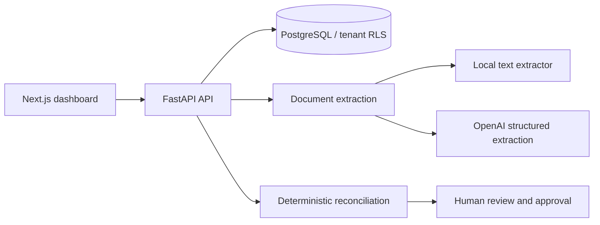

# ReconcileAI

An invoice and purchase-order reconciliation workspace built with **FastAPI, PostgreSQL, Next.js, and Docker**. AI extracts candidate invoice fields; deterministic checks compare them with purchase orders, and a human approver makes the final decision.

## What it demonstrates

- Vendor and purchase-order management with invoice reconciliation.
- PDF and image intake, structured extraction through OpenAI, and a local fallback for text-based PDFs.
- Explainable checks for vendor, currency, and amount, plus duplicate-invoice prevention.
- PostgreSQL tenant row-level security, Google sign-in, and role-based review workflows.
- A review step between extracted data and a financial approval decision.

## Architecture



## Run locally

You need Git and Docker with Docker Compose v2. The dashboard sign-in flow also requires Google OAuth credentials; OpenAI is optional for text-based PDF extraction.

```sh
git clone https://github.com/Narasimha9271/Reconcile-AI.git
cd Reconcile-AI
```

1. Copy [`.env.example`](.env.example) to `.env` in the repository root.
2. Configure Google OAuth using [the setup guide](docs/GOOGLE-OAUTH.md). Set the allowed email addresses and a generated session secret. Set finance approver emails if you want to exercise approval actions.
3. Optionally set `OPENAI_API_KEY` for AI extraction. See [extraction behavior and limits](docs/AI-INVOICE-EXTRACTION.md).
4. Start the stack:

```sh
docker compose up --build
```

| Service | Local address |
| --- | --- |
| Dashboard | http://localhost:3000 |
| Interactive API docs | http://localhost:8000/docs |
| Health check | http://localhost:8000/healthz |
| Google OAuth callback | http://localhost:4000/api/auth/google/callback |

The checked-in Compose configuration is for local development. Keep `.env` untracked and use sample data for evaluation.

## Try the workflow

1. Sign in and create a vendor and purchase order.
2. Upload a sample invoice or enter invoice details.
3. Review and correct extracted fields before running reconciliation.
4. Inspect the match result and the reasons for discrepancies.
5. Sign in as a configured Finance Approver to approve or reject the case.

Follow the [demo walkthrough](docs/DEMO-WALKTHROUGH.md), [sample-data guide](docs/SAMPLE-DATA.md), and [functional checks](docs/RUNBOOK.md) for concrete examples.

## Extraction behavior

- With a configured API key, invoice data is sent to OpenAI for structured extraction.
- Without a key, text-based PDFs use local extraction; images require a working key.
- Uploaded documents are limited to 8 MB. Scanned PDFs should be exported as clear images for this version.
- Extracted values are suggestions for review. The model does not approve or pay invoices.

## Stop or reset

Stop the stack while preserving the local database:

```sh
docker compose down
```

For an intentional fresh start only, `docker compose down -v` deletes the local PostgreSQL volume and its records. The SQL initialization scripts run when a fresh database volume is created; ordinary restarts do not reapply them. Back up anything you need before resetting.

## Documentation

- [Local runbook](docs/RUNBOOK.md)
- [Architecture](docs/ARCHITECTURE.md)
- [Security notes](docs/SECURITY.md)
- [Google OAuth](docs/GOOGLE-OAUTH.md) and [role access](docs/ROLE-ACCESS.md)
- [AI invoice extraction](docs/AI-INVOICE-EXTRACTION.md)
- [Duplicate-invoice prevention](docs/DUPLICATE-INVOICE-PREVENTION.md)

## Project scope

This is a portfolio application with a local development stack. Production deployment requires further work on tenant onboarding, identity configuration, durable file storage, malware scanning, and operational controls; see the security and architecture notes.
